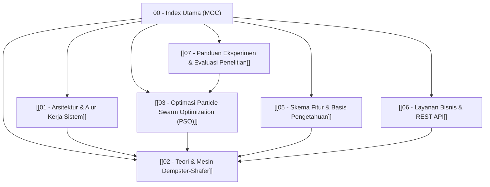

# Second Brain: Sistem Pakar Diagnosis Kerusakan iPhone (DS-PSO)

Selamat datang di **Second Brain Knowledge Base** untuk proyek **Sistem Pakar Diagnosis Kerusakan iPhone berbasis Dempster-Shafer & Particle Swarm Optimization (DS-PSO)**.

Catatan ini dirancang khusus untuk **Obsidian**, lengkap dengan bidirectional links (`[[...]]`), diagram alur (Mermaid), serta perumusan matematika (LaTeX).

---

## Map of Content (MOC)

Gunakan peta navigasi di bawah ini untuk menjelajahi seluruh modul, teori, dan implementasi kode:

---

## Daftar Catatan Utama

1. **[[01 - Arsitektur & Alur Kerja Sistem]]**
   - Gambaran umum arsitektur sistem pakar dan Streamlit Runner.
   - Diagram sekuens alur dari input gejala hingga hasil diagnosis akhir.
   - Pemisahan evaluasi software vs penalaran hardware DS-PSO.

2. **[[02 - Teori & Mesin Dempster-Shafer]]**
   - Konsep dasar teori evidence Dempster-Shafer.
   - Frame of Discernment ($\Theta$) dan fungsi massa (basic probability assignment / $m$).
   - Aturan kombinasi Dempster (Dempster's Rule of Combination) dan penanganan konflik ($K$).
   - Transformasi Probabilitas Pignistik (Pignistic Probability Transformation / $BetP$).
   - Bedah fungsi pada [`core/ds_engine.py`](file:///e:/Deskop/deteksiKerusakanIphone/core/ds_engine.py).

3. **[[03 - Optimasi Particle Swarm Optimization (PSO)]]**
   - Mengapa PSO dibutuhkan dalam Dempster-Shafer.
   - Vektor partikel, kecepatan (velocity), posisi (position), dan batasan (clipping constraints).
   - Fungsi kebugaran (fitness function) berbasis Multiclass Brier Score.
   - Mekanisme inertia weight damping dan percepatan kognitif/sosial ($c_1, c_2$).
   - Bedah skrip eksperimen pada [`core/run_experiment.py`](file:///e:/Deskop/deteksiKerusakanIphone/core/run_experiment.py).

4. **[[05 - Skema Fitur & Basis Pengetahuan]]**
   - 13 Fitur gejala teknis hardware iPhone.
   - 15 Kelas target kerusakan hardware iPhone.
   - 19 Pasangan aturan evidence (aturan relasi gejala $\rightarrow$ hipotesis kerusakan).
   - Perbandingan matriks belief pakar awal ([`data/belief.json`](file:///e:/Deskop/deteksiKerusakanIphone/data/belief.json)) vs hasil optimasi PSO ([`data/optimal_knowledge_base.json`](file:///e:/Deskop/deteksiKerusakanIphone/data/optimal_knowledge_base.json)).

5. **[[06 - Layanan Bisnis & REST API]]**
   - Struktur antarmuka Streamlit Model Hub pada [`app.py`](file:///e:/Deskop/deteksiKerusakanIphone/app.py).
   - Pengetahuan klinis perbaikan iPhone pada [`core/clinical_knowledge.py`](file:///e:/Deskop/deteksiKerusakanIphone/core/clinical_knowledge.py).
   - Kebijakan tingkat keyakinan (confidence policy) dan penanganan kasus hardware.

6. **[[07 - Panduan Eksperimen & Evaluasi Penelitian]]**
   - Alur reproduksi riset dari data mentah hingga pengujian model.
   - Skrip preprocessing ([`core/preprocessing_service.py`](file:///e:/Deskop/deteksiKerusakanIphone/core/preprocessing_service.py)).
   - Evaluasi metrik multiclass (Accuracy, Precision, Recall, Macro F1, Brier Score).
   - Perbandingan komparasi metrik performa model (Baseline DS vs DS-PSO).

---

> [!TIP]
> Tips Navigasi Obsidian:
> - Tekan `Ctrl + O` untuk mencari catatan berdasarkan nama.
> - Buka Graph View (`Ctrl + G`) untuk melihat keterkaitan antar konsep secara visual.
> - Aktifkan Backlinks di panel samping untuk melihat semua catatan yang mereferensikan topik yang sedang Anda baca.
