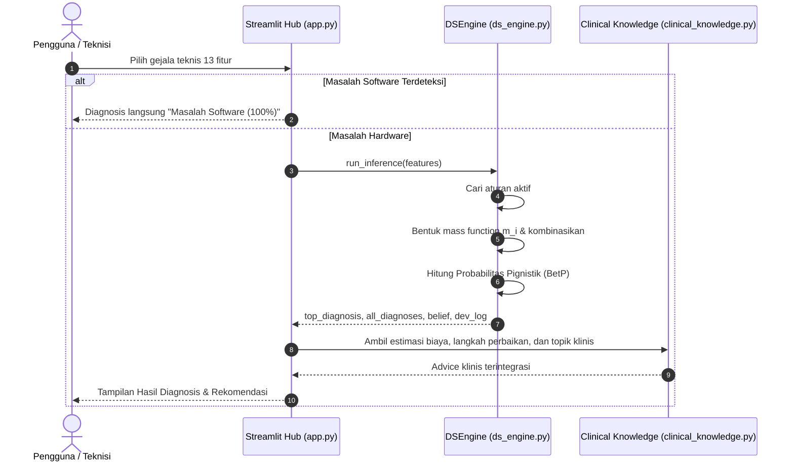
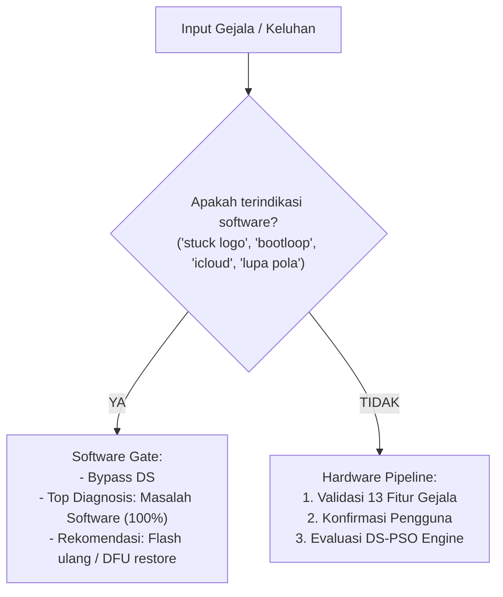

# 01 - Arsitektur & Alur Kerja Sistem

Catatan ini mendokumentasikan arsitektur menyeluruh sistem pakar diagnosis kerusakan iPhone, keterhubungan antar modul, dan alur pemrosesan data dari input fitur hingga inferensi akhir.

Parent: [[00 - Index Utama (MOC)]]  
Terkait: [[02 - Teori & Mesin Dempster-Shafer]], [[05 - Skema Fitur & Basis Pengetahuan]], [[06 - Layanan Bisnis & REST API]]

---

## Prinsip Desain Arsitektur

1. **Determinisme & Validasi Skema**:
   - Nilai fitur gejala diuji dan divalidasi dengan skema dataset ([`data/model_schema.json`](file:///e:/Deskop/deteksiKerusakanIphone/data/model_schema.json)). Jika ada nilai di luar domain kategorikal, nilai tersebut otomatis dikembalikan ke nilai default normal.
2. **Mesin Inferensi Dempster-Shafer (DS-PSO)**:
   - Bertindak sebagai mesin inferensi matematis deterministik yang mengevaluasi bukti ketidakpastian (uncertainty) berdasarkan basis pengetahuan optimal hasil optimasi PSO.
3. **Pemisahan Masalah Software vs Hardware**:
   - Kasus masalah sistem operasi/software (misal: bootloop, iCloud lock, stuck logo) difilter terlebih dahulu (Software Gate) sebelum masuk ke penalaran hardware DS-PSO.

---

## Diagram Alur Kerja (End-to-End Pipeline)

---

## Peta Modul Proyek

| Modul / Berkas | Lokasi | Peran Utama | Catatan Terkait |
|---|---|---|---|
| **Streamlit Entrypoint** | [`app.py`](file:///e:/Deskop/deteksiKerusakanIphone/app.py) | Aplikasi Eksekusi & Visualisasi Model | [[06 - Layanan Bisnis & REST API]] |
| **DS Engine** | [`core/ds_engine.py`](file:///e:/Deskop/deteksiKerusakanIphone/core/ds_engine.py) | Inferensi Dempster-Shafer & Pignistik | [[02 - Teori & Mesin Dempster-Shafer]] |
| **Feature Schema** | [`core/feature_schema.py`](file:///e:/Deskop/deteksiKerusakanIphone/core/feature_schema.py) | Kontrak 13 fitur dan validasi ketat | [[05 - Skema Fitur & Basis Pengetahuan]] |
| **Model Validator** | [`core/model_validator.py`](file:///e:/Deskop/deteksiKerusakanIphone/core/model_validator.py) | Validasi keabsahan file model JSON | [[05 - Skema Fitur & Basis Pengetahuan]] |
| **Clinical Knowledge** | [`core/clinical_knowledge.py`](file:///e:/Deskop/deteksiKerusakanIphone/core/clinical_knowledge.py) | Pengetahuan klinis perbaikan iPhone | [[06 - Layanan Bisnis & REST API]] |
| **Riset & PSO** | [`core/run_experiment.py`](file:///e:/Deskop/deteksiKerusakanIphone/core/run_experiment.py) | Eksperimen pelatihan PSO & evaluasi test set | [[03 - Optimasi Particle Swarm Optimization (PSO)]] |

---

## Software Gate vs Hardware Path

Sistem memiliki pembagian alur sejak tahap awal:

> [!NOTE]
> Pembagian ini memastikan mesin inferensi Dempster-Shafer murni berkonsentrasi pada kompleksitas kerusakan fisik hardware komponen (15 kelas kerusakan), sementara masalah sistem operasi diselesaikan melalui protokol pemulihan firmware (iTunes / 3uTools).
