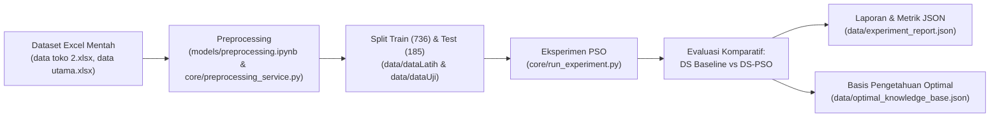

# 07 - Panduan Eksperimen & Evaluasi Penelitian

Catatan ini mendokumentasikan metodologi eksperimen, pemrosesan dataset mentah, evaluasi komparatif (Dempster-Shafer Baseline vs DS-PSO), dan metrik performa model.

Parent: [[00 - Index Utama (MOC)]]  
Terkait: [[02 - Teori & Mesin Dempster-Shafer]], [[03 - Optimasi Particle Swarm Optimization (PSO)]], [[05 - Skema Fitur & Basis Pengetahuan]]

---

## 1. Alur Penelitian Reproducible

Proyek ini dibangun untuk mendukung eksperimen ilmiah yang dapat direproduksi (*reproducible research*):



---

## 2. Preprocessing Data

Skrip [`core/preprocessing_service.py`](file:///e:/Deskop/deteksiKerusakanIphone/core/preprocessing_service.py) dan notebook [`models/preprocessing.ipynb`](file:///e:/Deskop/deteksiKerusakanIphone/models/preprocessing.ipynb) menjalankan:
1. Pembersihan duplikasi dan inkonsistensi penamaan kolom.
2. Penyelarasan label kelas target (15 kelas kerusakan standar).
3. Pemisahan data:
   - **Data Latih (Train Set)**: 736 baris untuk evaluasi fitness PSO.
   - **Data Uji (Test Set)**: 185 baris independen yang terkunci dan tidak pernah dilihat selama pelatihan PSO.

---

## 3. Metrik Evaluasi Ilmiah

Evaluasi dilakukan pada test set yang sama untuk membandingkan:
1. **Dempster-Shafer Baseline**: Menggunakan bobot belief awal estimasi pakar manusia.
2. **Dempster-Shafer + PSO**: Menggunakan bobot belief hasil optimasi swarm.

Metrik yang dihitung meliputi:
- **Accuracy**: Persentase diagnosis top-1 yang tepat terhadap ground truth.
- **Macro F1-Score**: Rata-rata F1 per kelas tanpa memandang ketidakseimbangan kelas (kritis untuk kelas minoritas seperti `IC Cas Rusak` atau `IC Audio Rusak`).
- **Weighted F1-Score**: Rata-rata F1 berbobot proporsi jumlah kasus.
- **Multiclass Brier Score**: Mengukur akurasi kalibrasi probabilitas ($0$ adalah sempurna, $1$ adalah acak).
- **Confusion Matrix**: Matriks $15 \times 15$ untuk melihat distribusi misklasifikasi antar komponen terkait.

---

## 4. Audit Potensi Data Leakage

Skrip eksperimen dilengkapi dengan fungsi `leakage_audit(dataframe)`:
- Memeriksa apakah teks deskripsi mentah (`Raw_Text`) memuat istilah diagnosis secara eksplisit yang berpotensi membocorkan label ke dalam model fitur.
- Memastikan bahwa model inferensi DS hanya mengevaluasi bukti gejala objektif, bukan kebocoran label verbal.

---

## 5. Menjalankan Eksperimen & Evaluasi Model

Eksperimen pembanding antara Dempster-Shafer baseline dan optimasi PSO dapat dijalankan menggunakan:
- Matriks aturan awal pakar: [`data/belief.json`](file:///e:/Deskop/deteksiKerusakanIphone/data/belief.json)
- Skrip otomasi eksperimen: [`core/run_experiment.py`](file:///e:/Deskop/deteksiKerusakanIphone/core/run_experiment.py)

Semua tabel perbandingan, grafik konvergensi PSO, dan matriks confusion dapat dihasilkan secara otomatis ke folder `data/` menggunakan perintah:

```bash
pip install -r requirements.txt
python core/run_experiment.py --particles 30 --iterations 100 --seed 42
```


